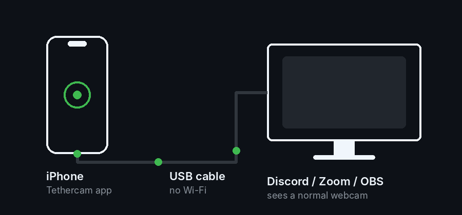

<div align="center">

# tethercam

**Use your iPhone as a webcam on Windows, with one USB cable.**

[](https://github.com/kirawins17/tethercam/actions/workflows/ci.yml)
[](https://github.com/kirawins17/tethercam/releases/latest)
[](LICENSE)



Works with Discord, Zoom, Teams, OBS and Google Meet. No Wi-Fi. No account. No Mac. Free.

</div>

## Setup (about 10 minutes, one time)

### 1. Run the installer on your PC

**[⬇ Download Install-Tethercam.bat](https://github.com/kirawins17/tethercam/releases/latest/download/Install-Tethercam.bat)**, then double-click it.

The installer shows you this list and asks before it starts. It skips what you already have.

| It installs | Why you need it |
|---|---|
| Python | Runs the Tethercam program. |
| OBS Studio | Adds the "OBS Virtual Camera" that Discord and Zoom can see. You never need to open OBS. |
| iTunes | Lets your PC talk to your iPhone over the cable. |
| Sideloadly | Puts the Tethercam app on your iPhone. |
| Tethercam | The program, the iPhone app file, and a **Tethercam** shortcut on your desktop. |

> If Windows shows "Windows protected your PC", click **More info › Run anyway**. The file is 4 lines; you can [read it here](Install-Tethercam.bat).

### 2. Put the app on your iPhone

At the end, the installer opens Sideloadly and the folder with `Tethercam.ipa`.

1. Plug your iPhone into the PC. Unlock it. Tap **Trust**.
2. Drag `Tethercam.ipa` into Sideloadly. Type your Apple ID. Click **Start**.
3. On the iPhone: **Settings › General › VPN & Device Management** › your Apple ID › **Trust**.
4. On the iPhone: **Settings › Privacy & Security › Developer Mode** › **On**. The iPhone restarts.

> A free Apple ID makes the app stop after 7 days. To renew it, do step 2 again.

### 3. Use it

1. Plug in the iPhone. Open the **Tethercam** app. Keep it on the screen.
2. Double-click **Tethercam** on your PC desktop.
3. In Discord: **Settings › Voice & Video › Camera › OBS Virtual Camera**.

Put the iPhone on its side for the best picture.

## Problems?

| You see | Do this |
|---|---|
| `No iPhone found over USB` | Unlock the iPhone. Tap **Trust**. Try another cable or USB port. |
| `Can't reach Apple's USB service` | Install iTunes from [apple.com](https://www.apple.com/itunes/), not the Microsoft Store. Restart the PC. |
| `the Tethercam app isn't open` | Open the app on the iPhone. Keep it on the screen. |
| `Could not start the virtual webcam` | Close OBS if it is open. If it is not installed, run the installer again. |
| The picture is sideways | Put the iPhone on its side, or see the options below. |
| Discord does not show the camera | Close Discord fully, then open it again. |

Still stuck? [Ask in Discussions](https://github.com/kirawins17/tethercam/discussions).

<details>
<summary><b>Options</b></summary>

Edit the desktop shortcut and add these to the end, or run `python tethercam.py` with them:

| Option | What it does |
|---|---|
| `--rotate 90` | Turns the picture. Use 0, 90, 180 or 270. |
| `--mirror` | Flips the picture left to right. |
| `--width 1920 --height 1080` | Changes the size. The default is 1280 × 720. |
| `--preview` | Shows the picture in a window on the PC. |
| `--udid <id>` | Selects one iPhone when more than one is connected. |

</details>

<details>
<summary><b>Install without the .bat file</b></summary>

Open PowerShell and run:

```powershell
irm https://raw.githubusercontent.com/kirawins17/tethercam/main/install.ps1 | iex
```

Or install by hand: Python, [OBS Studio](https://obsproject.com/), [iTunes](https://www.apple.com/itunes/) and [Sideloadly](https://sideloadly.io/). Then download this repo, run `pc/start-tethercam.bat`, and get `Tethercam.ipa` from [Releases](https://github.com/kirawins17/tethercam/releases/latest).

</details>

<details>
<summary><b>How it works</b></summary>

The design comes from [scrcpy](https://github.com/Genymobile/scrcpy), which does the same thing for Android phones.

```
iPhone camera ─► Tethercam app ─► USB cable (Apple usbmux) ─► tethercam.py ─► OBS Virtual Camera ─► Discord
```

| | scrcpy (Android) | tethercam (iPhone) |
|---|---|---|
| Cable connection | `adb forward` | Apple usbmux (comes with iTunes) |
| Phone side | scrcpy-server | Tethercam app ([`ios/`](ios/)) |
| Video | H.264 | JPEG frames: 4-byte length, then the image |
| PC webcam | V4L2 (Linux only) | OBS Virtual Camera via [pyvirtualcam](https://github.com/letmaik/pyvirtualcam) |

</details>

## Privacy and security

- The video goes only through the USB cable. It never goes to the internet.
- The iPhone app accepts only the cable. Other devices on your Wi-Fi cannot connect to it.
- No accounts, no analytics, no tracking.
- Found a security problem? See [SECURITY.md](SECURITY.md).

## Contribute

Help is welcome. Read [CONTRIBUTING.md](CONTRIBUTING.md). [`good first issue`](https://github.com/kirawins17/tethercam/labels/good%20first%20issue) issues are a good start.

## License

[MIT](LICENSE). Thanks to [scrcpy](https://github.com/Genymobile/scrcpy), [Scrcpy-Camera](https://github.com/xeniumcode/Scrcpy-Camera) and [scrcpy-camera](https://github.com/NanKillBro/scrcpy-camera) for the ideas.
