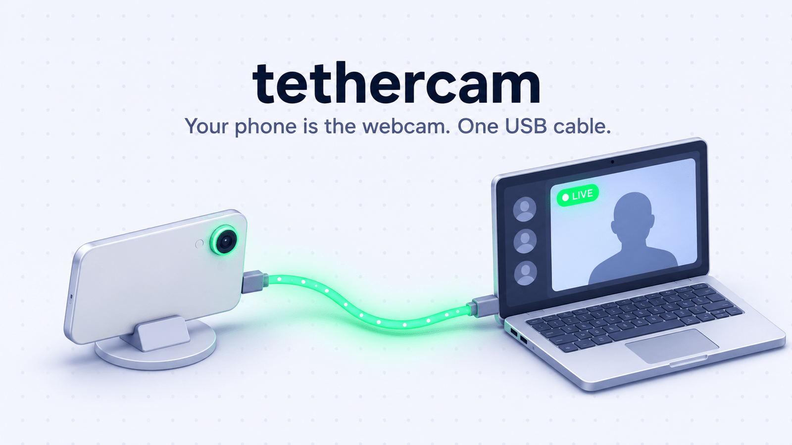
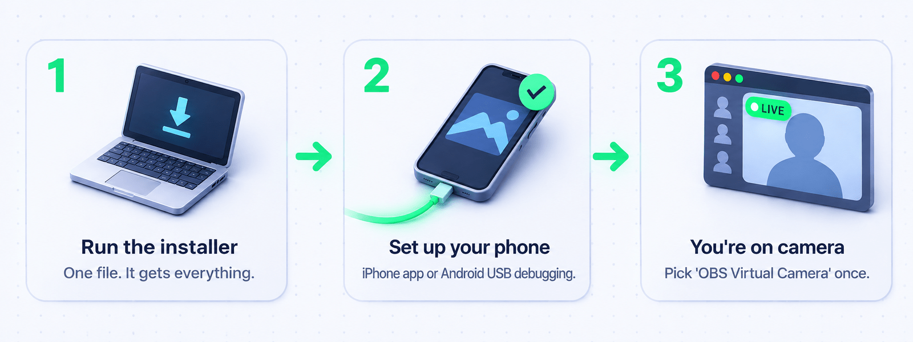
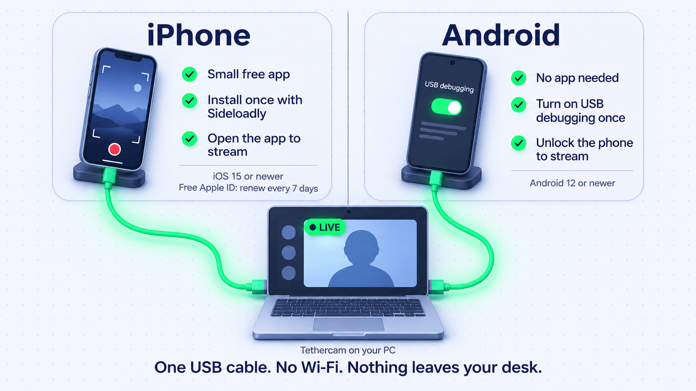
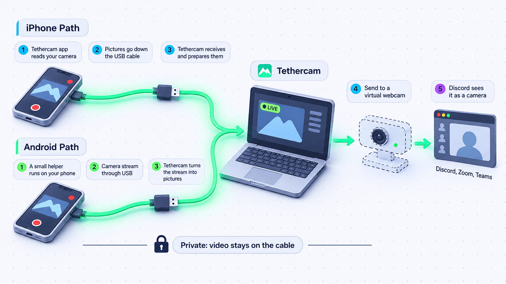

<div align="center">

# tethercam

**Use your phone as a webcam on your PC, with one USB cable.**

iPhone or Android · Windows or Linux

[](https://github.com/kirawins17/tethercam/actions/workflows/ci.yml)
[](https://github.com/kirawins17/tethercam/releases/latest)
[](LICENSE)
[](https://scorecard.dev/viewer/?uri=github.com/kirawins17/tethercam)

<picture>
  <source media="(prefers-color-scheme: dark)" srcset="docs/hero-dark.png">
  <source media="(prefers-color-scheme: light)" srcset="docs/hero-light.png">
  
</picture>

Works with Discord, Zoom, Teams, OBS and Google Meet. No Wi-Fi. No account. Free.

</div>

## Setup (one time)

<picture>
  <source media="(prefers-color-scheme: dark)" srcset="docs/setup-steps-dark.png">
  <source media="(prefers-color-scheme: light)" srcset="docs/setup-steps-light.png">
  
</picture>

### 1. Install on your PC

**Windows:** **[⬇ Download Install-Tethercam.bat](https://github.com/kirawins17/tethercam/releases/latest/download/Install-Tethercam.bat)**, then double-click it.

**Linux:** open a terminal and run:

```sh
curl -fsSL https://raw.githubusercontent.com/kirawins17/tethercam/main/install.sh | bash
```

The installer shows what it will install and asks before it starts. It skips what you already have. On Windows, it also asks which phone you have and installs only what that phone needs.

| It installs | Why you need it |
|---|---|
| Python | Runs the Tethercam program. |
| Virtual webcam | OBS Studio on Windows, v4l2loopback on Linux. This is the camera that Discord sees. You never need to open OBS. |
| **iPhone only:** iTunes (Windows) or usbmuxd (Linux) | Lets your PC talk to an iPhone over the cable. |
| **iPhone only:** Sideloadly (Windows) | Puts the Tethercam app on your iPhone. |
| **Android only:** adb | Lets your PC talk to an Android phone over the cable. |
| Tethercam | The program and a **Tethercam** shortcut. |

> On Windows, if you see "Windows protected your PC", click **More info › Run anyway**. The file is only a few lines; you can [read it here](Install-Tethercam.bat).

### 2. Set up your phone

<picture>
  <source media="(prefers-color-scheme: dark)" srcset="docs/iphone-vs-android-dark.png">
  <source media="(prefers-color-scheme: light)" srcset="docs/iphone-vs-android-light.png">
  
</picture>

<table>
<tr><th>iPhone (iOS 15 or newer)</th><th>Android (12 or newer)</th></tr>
<tr><td valign="top">

The installer opens Sideloadly and the folder with `Tethercam.ipa`.

1. Plug in the iPhone. Unlock it. Tap **Trust**.
2. Drag `Tethercam.ipa` into Sideloadly. Type your Apple ID. Click **Start**.
3. **Settings › General › VPN & Device Management** › your Apple ID › **Trust**.
4. **Settings › Privacy & Security › Developer Mode** › **On**. The iPhone restarts.

A free Apple ID makes the app stop after 7 days. To renew it, do step 2 again.

</td><td valign="top">

No app needed.

1. **Settings › About phone**. Tap **Build number** 7 times.
2. **Settings › System › Developer options › USB debugging** › **On**.
3. Plug the phone into the PC. Tap **Allow**.

</td></tr>
</table>

### 3. Use it

1. Plug in the phone. **iPhone:** open the Tethercam app and keep it on the screen. **Android:** unlock the phone.
2. Open **Tethercam** on your PC (desktop shortcut on Windows, app menu on Linux).
3. In Discord, go to **Settings › Voice & Video › Camera**. Pick **OBS Virtual Camera** (Windows) or **tethercam** (Linux).

Put the phone on its side for the best picture.

## How it works

<picture>
  <source media="(prefers-color-scheme: dark)" srcset="docs/how-it-works-dark.png">
  <source media="(prefers-color-scheme: light)" srcset="docs/how-it-works-light.png">
  
</picture>

The picture goes one way: phone camera, USB cable, Tethercam on your PC, a virtual webcam, then your video app. It never goes to the internet. The technical details are under **Technical details** below.

## Problems?

| You see | Do this |
|---|---|
| `No phone found` | Unlock the phone. iPhone: tap **Trust**. Android: turn on USB debugging and tap **Allow**. Try another cable or USB port. |
| `Can't reach Apple's USB service` | Install iTunes from [apple.com](https://www.apple.com/itunes/), not the Microsoft Store. Restart the PC. |
| `the Tethercam app isn't open` | Open the app on the iPhone. Keep it on the screen. |
| `The camera needs Android 12 or newer` | Android camera streaming needs Android 12+. |
| `Could not start the virtual webcam` | Windows: close OBS if it is open. Linux: run `sudo modprobe v4l2loopback exclusive_caps=1 card_label=tethercam`. |
| The picture is sideways | Put the phone on its side, or use `--rotate 90`. |
| Discord does not show the camera | Close Discord fully, then open it again. |

Still stuck? See [SUPPORT.md](SUPPORT.md) or [ask in Discussions](https://github.com/kirawins17/tethercam/discussions).

<details>
<summary><b>Options</b></summary>

Add these after the command (`start-tethercam.bat` or `start-tethercam.sh`), or edit the shortcut:

| Option | What it does |
|---|---|
| `--phone iphone` / `--phone android` | Use this phone type. The default finds the phone that is plugged in. |
| `--camera front` | Android: use the front camera. iPhone: switch in the app. |
| `--rotate 90` | Turns the picture. Use 0, 90, 180 or 270. |
| `--mirror` | Flips the picture left to right. |
| `--width 1920 --height 1080` | Changes the webcam size. The default is 1280 × 720. Android sends up to this size. The iPhone app always sends 1280 × 720, so a bigger size only scales it up. |
| `--fps 60` | Changes the frame rate. The default is 30. |
| `--preview` | Shows the picture in a window on the PC. |
| `--device <id>` | Selects one phone when more than one is connected. |
| `--version` | Shows the Tethercam version. Add it to bug reports. |

</details>

<details>
<summary><b>Install by hand</b></summary>

1. Install Python 3.9+ and a virtual webcam: [OBS Studio](https://obsproject.com/) on Windows, `v4l2loopback` on Linux.
2. iPhone: install [iTunes](https://www.apple.com/itunes/) (Windows) or `usbmuxd` (Linux), and install `Tethercam.ipa` from [Releases](https://github.com/kirawins17/tethercam/releases/latest) with [Sideloadly](https://sideloadly.io/) or [Sideloader](https://github.com/Dadoum/Sideloader).
3. Android: install [adb](https://developer.android.com/tools/releases/platform-tools).
4. Download this repo. Run `pc/start-tethercam.bat` (Windows) or `pc/start-tethercam.sh` (Linux).

</details>

<details>
<summary><b>Uninstall</b></summary>

**Windows:** delete the **Tethercam** shortcut on the desktop and the folder `%LOCALAPPDATA%\tethercam`. You can uninstall OBS Studio, iTunes, Sideloadly and Android platform-tools in **Settings › Apps** if you do not use them for other things.

**Linux:** run

```sh
rm -rf ~/.local/share/tethercam ~/.local/share/applications/tethercam.desktop
sudo rm -f /etc/modules-load.d/tethercam.conf /etc/modprobe.d/tethercam.conf
```

**iPhone:** delete the Tethercam app. **Android:** turn off USB debugging. Nothing else is left on the phone.

</details>

<details>
<summary><b>Technical details</b></summary>

```
iPhone:  Tethercam app ─► Apple usbmux (USB) ─► JPEG frames ──┐
                                                              ├─► tethercam ─► virtual webcam ─► Discord
Android: scrcpy server ─► adb (USB) ─────────► H.264 video ──┘
```

- **iPhone:** our own small app ([`ios/`](ios/)) sends JPEG frames through Apple's USB service.
- **Android:** we use the server from [scrcpy](https://github.com/Genymobile/scrcpy). Tethercam downloads the official file once and checks it against a fixed SHA-256. It runs only while you stream, and it removes itself when it stops. Nothing is installed on the phone.
- **PC:** [pyvirtualcam](https://github.com/letmaik/pyvirtualcam) sends the picture to OBS Virtual Camera (Windows) or v4l2loopback (Linux).

</details>

## FAQ

<details>
<summary><b>Is it safe?</b></summary>

Yes. All code is open, and every release is built by GitHub Actions from this code. Each release has a `SHA256SUMS.txt` file, and public releases have signed build provenance, so you can check that the files came from this repository. See [SECURITY.md](SECURITY.md#check-a-download).

</details>

<details>
<summary><b>Why must I install the iPhone app with Sideloadly?</b></summary>

Tethercam is not in the App Store, so you install it yourself. Sideloadly signs the app with your own Apple ID, so it runs only on your iPhone. With a free Apple ID you must renew it every 7 days.

</details>

<details>
<summary><b>Does it work on a Mac?</b></summary>

Not yet. macOS already has Continuity Camera for iPhone. Help for Android on macOS is welcome: see [CONTRIBUTING.md](CONTRIBUTING.md).

</details>

<details>
<summary><b>Does it record or upload my video?</b></summary>

No. The video goes from the phone to your PC through the cable and nowhere else. Tethercam has no servers.

</details>

<details>
<summary><b>Which apps can use it?</b></summary>

Every app that can select a webcam: Discord, Zoom, Teams, Google Meet, OBS and browsers.

</details>

## Roadmap

- Tray icon on Windows ([#1](https://github.com/kirawins17/tethercam/issues/1))
- Auto-rotate when the phone is upright ([#2](https://github.com/kirawins17/tethercam/issues/2))
- Frame rate counter in the app ([#3](https://github.com/kirawins17/tethercam/issues/3))
- More languages for the README ([#4](https://github.com/kirawins17/tethercam/issues/4))

Have an idea? [Start a discussion](https://github.com/kirawins17/tethercam/discussions).

## Privacy and security

- The video goes only through the USB cable. It never goes to the internet.
- The only download while you use it: for Android, Tethercam gets the official scrcpy server from GitHub one time.
- The iPhone app accepts only the cable. Other devices on your Wi-Fi cannot connect to it.
- No accounts, no analytics, no tracking.
- Found a security problem? See [SECURITY.md](SECURITY.md).

## Credits

Tethercam stands on the work of other people. Thank you:

- **[scrcpy](https://github.com/Genymobile/scrcpy)** by Genymobile and Romain Vimont: the design idea, and the server that streams the Android camera.
- **[Scrcpy-Camera](https://github.com/xeniumcode/Scrcpy-Camera)** by xeniumcode and **[scrcpy-camera](https://github.com/NanKillBro/scrcpy-camera)** by NanKillBro: they showed how to use a phone camera as a webcam with scrcpy.
- **[pyvirtualcam](https://github.com/letmaik/pyvirtualcam)**, **[PyAV](https://github.com/PyAV-Org/PyAV)**, **[OpenCV](https://github.com/opencv/opencv-python)**, **[OBS Studio](https://github.com/obsproject/obs-studio)**, **[v4l2loopback](https://github.com/umlaeute/v4l2loopback)**, **[libimobiledevice / usbmuxd](https://github.com/libimobiledevice)** and **[XcodeGen](https://github.com/yonaskolb/XcodeGen)**.

The full list, with licenses, is in [CREDITS.md](CREDITS.md).

## Contribute

Help is welcome. Read [CONTRIBUTING.md](CONTRIBUTING.md) and our [Code of Conduct](CODE_OF_CONDUCT.md). [`good first issue`](https://github.com/kirawins17/tethercam/labels/good%20first%20issue) issues are a good start.

## License and legal

- Tethercam's code is under the [MIT license](LICENSE). The tools it uses keep their own licenses: see [CREDITS.md](CREDITS.md).
- Use Tethercam within the law. Ask people before you record or stream them.
- Tethercam comes with no warranty. See the [license](LICENSE).
- iPhone is a trademark of Apple Inc., registered in the U.S. and other countries. Android is a trademark of Google LLC. Discord, Zoom and other names are trademarks of their owners. Tethercam is not made by, sponsored by or connected with any of these companies.
